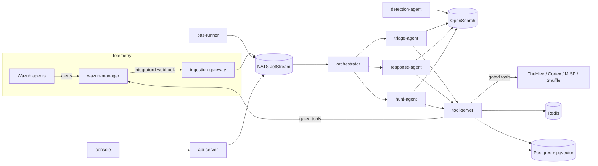

# Mesta-Ares

Agentic SIEM+SOAR. Wazuh + OpenSearch collect and correlate; TheHive, Cortex,
MISP, and Shuffle handle cases, analysis, intel, and workflows; a Rust
control plane (`tool-server`, `orchestrator`, and per-role agents on a NATS
JetStream bus) triages, hunts, and responds **autonomously** inside a strict
policy envelope.

## Architecture



`tool-server` is the only path to side effects: every tool call passes the
policy gate before execution.

## Security model

- **Autonomous by default, gated by policy.** `policies/tools.yml` is a
  deny-by-default allowlist: each tool has an `impact` class, an `autonomy`
  level, arg schemas, and blast-radius caps (rate limits + cooldowns).
- **Hard boundary.** `policies/protected-assets.yml` lists assets (domain
  controllers, Tier-0 accounts, RFC1918 ranges, the control plane itself)
  that can never be the target of a write/high-impact call — not
  runtime-overridable; changes require a commit.
- **Kill switch.** Revoke the `tool-server`'s NATS credentials (or stop the
  service) and every agent loses the ability to act while keeping read
  access to data.
- **Detection-as-code.** Rules live in `detection-content/`, are drafted by
  the agent into `pending/`, backtested, and promoted to `active/` only by
  commit — then deployed as OpenSearch monitors.
- **Audit.** Tool calls, denials, and verdicts are persisted for replay
  (see `evals/`).

## Quickstart

```sh
cp .env.example .env            # fill in API keys
docker compose -f infra/docker-compose.yml up -d
```

Then:

| Console | URL |
|---|---|
| Ares console | http://localhost:3000 |
| api-server | http://localhost:8080 |
| TheHive | http://localhost:9000 |
| Cortex | http://localhost:9001 |
| Shuffle | http://localhost:3001 |
| MISP | https://localhost:8443 |
| Wazuh dashboard | http://localhost:5601 (`--profile wazuh-ui`) |
| OpenSearch | http://localhost:9200 |

To receive Wazuh alerts, add the block in `infra/wazuh/integratord.xml` to
`ossec.conf` inside the manager container (the forwarder script is already
bind-mounted at `/var/ossec/integrations/custom-ares-webhook`).

Production skeleton: `helm install ares infra/helm/ares` after creating an
`ares-secrets` Secret and setting `global.imageRegistry`. Plain Kubernetes
manifests for the same stack live in `infra/k8s` — deploy with
`./infra/k8s/apply.sh` (see `infra/k8s/README.md`).

## Repo layout

| Path | Contents |
|---|---|
| `crates/` | Rust workspace: tool-server, api-server, ingestion-gateway, orchestrator, triage/response/detection/hunt agents, bas-runner |
| `apps/console/` | Next.js console |
| `infra/` | docker-compose dev stack, Dockerfiles, Helm chart, plain k8s manifests, Wazuh integration |
| `policies/` | Tool allowlist + protected assets (policy gate inputs) |
| `detection-content/` | Sigma rules — `active/` deployed, `pending/` agent drafts |
| `evals/` | Golden sets + policy negative-test matrix for offline eval |
| `bas/` | Breach-and-attack-simulation scenario manifests |
| `.github/workflows/` | CI: rust fmt/clippy/test, sigma check, evals, console, compose validation |
